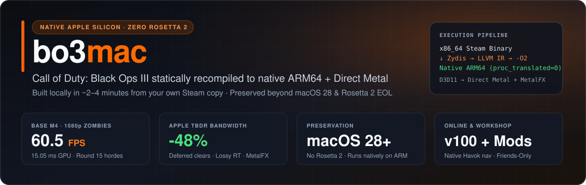
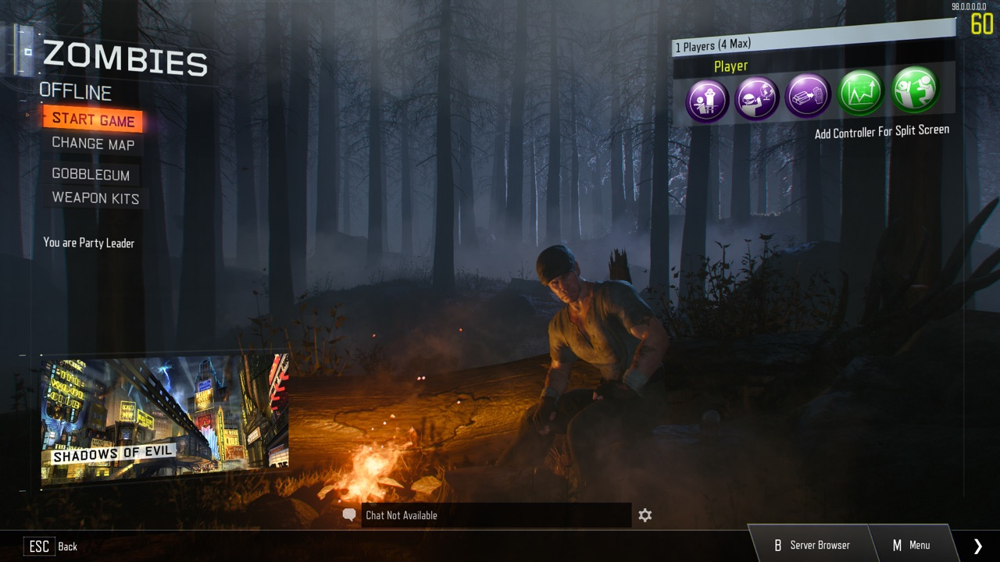
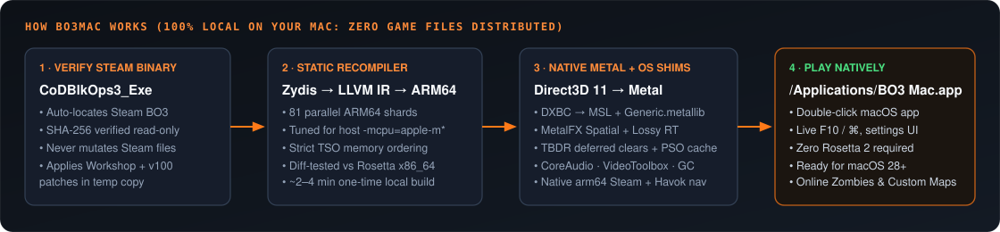

<div align="center">



<br><br>


<sub>
<a href="#why-bo3mac-preserved-past-macos-28">Why macOS 28+</a> ·
<a href="#performance--benchmarks">Performance</a> ·
<a href="#quick-start-3-steps-built-for-regular-players">Install</a> ·
<a href="#live-in-game-settings-f10-or-">Live Settings</a> ·
<a href="#online-multiplayer-zombies--steam-workshop">Online &amp; Workshop</a> ·
<a href="#hardware-compatibility">Compatibility</a> ·
<a href="#security--architecture-notes">Architecture</a>
</sub>

</div>

<br>

> [!IMPORTANT]
> **Ownership & Legal Notice: Zero Game Files Distributed**
> You **must own Call of Duty: Black Ops III on Steam** and have the macOS Steam version installed. This repository contains **zero copyrighted Activision, Treyarch, or Aspyr binaries, shaders, or assets**. `./install.sh` verifies your own Steam executable by SHA-256 and compiles a native ARM64 app locally on your Mac without modifying a single file inside Steam.

---

## Why `bo3mac`? Preserved Past macOS 28

Aspyr's official macOS port of **Call of Duty: Black Ops III** is an aging **x86_64** binary built on an older D3D11-to-Metal translation layer that:
- Relies on **Rosetta 2** on Apple Silicon, which Apple is deprecating after macOS 27 (**macOS 28+** removes general Rosetta 2 support, permanently breaking the stock Intel Steam binary and Rosetta-based mods).
- Bottlenecks heavily on a single emulated render thread and burns battery/thermals on fanless MacBook Airs.

**`bo3mac` statically recompiles Black Ops III into a 100% native Apple Silicon (`arm64`, `proc_translated=0`) macOS application** and replaces Aspyr's wrapper with a custom **Direct3D 11 → Metal + MetalFX Spatial** renderer tuned specifically for Apple's Tile-Based Deferred Rendering (TBDR) GPUs.

<p align="center">
  <br>
  <sub><b>Black Ops III Zombies</b> running natively on Apple Silicon ARM64 (<code>proc_translated=0</code>) via <code>bo3mac</code>'s Direct Metal backend.</sub>
</p>

### What Changes vs. Stock Steam BO3

| | Stock Steam BO3 (Aspyr) | **`bo3mac` (Native ARM64)** |
|---|---|---|
| **CPU Execution** | x86_64 via **Rosetta 2** | **100% Native ARM64** (`-mcpu=apple-m*`), zero Rosetta |
| **macOS 28+ Future (Post-Rosetta)** | Stops launching once Rosetta 2 is removed | **Preserved natively on Apple Silicon** |
| **Graphics Backend** | Aspyr's 2019 x86_64 D3D11→Metal wrapper | **Native ARM64 Direct3D 11 → Metal** TBDR renderer |
| **Upscaling & Bandwidth** | None | **MetalFX Spatial** + **Apple8+ Lossy RT** + deferred clears |
| **Steam Workshop & Custom Maps** | Broken navmesh/scripts without Rosetta mods | **Native ARM64 Havok nav converter** + mod fixes (zero Wine/Rosetta) |
| **Windows Cross-Play** | Stuck on macOS v98 protocol | **Windows v100 protocol** + Friends-Only lobby guard |
| **Live Graphics Tweaking** | Restart required | **In-game `F10` / `⌘,` overlay** (MetalFX, latency, HUD, safety) |

---

## How It Works

<p align="center">
  
</p>

1. **Zero-Slide Mach-O Loader (`bo3_loader`):** Maps your verified `CoDBlkOps3_Exe` data/read-only sections at their exact original 64-bit virtual addresses (`0x100008000`) with `__TEXT` non-executable (`PROT_READ`), then loads the freshly compiled native ARM64 engine (`libbo3_recomp.dylib`).
2. **Custom Zydis → LLVM IR Static Lifter (`bo3_lift`):** Lifts all Core BO3 x86_64 functions across **81 parallel ARM64 shards** compiled with `clang -O2 -mcpu=apple-m*` and strict TSO memory ordering, differentially verified instruction-by-instruction against Rosetta x86_64 execution.
3. **Apple-TBDR Direct Metal Backend (`metal/`):** Implements D3D11 directly on Metal with deferred clears, `MTLStoreActionDontCare` bandwidth elimination, persistent `MTLBinaryArchive` PSO caching, a zero-dependency DXBC → MSL translator (plus `Generic.metallib` reuse), **MetalFX Spatial Upscaling**, and **Apple8+ Lossy Render-Target Compression**.
4. **Native macOS Subsystems (`runtime/`):** CoreAudio (WASAPI), VideoToolbox H.264 cutscenes, `GameController.framework` with haptics, native arm64 `steamclient.dylib` bridge, and a clean-room native ARM64 Havok navigation converter for Steam Workshop custom maps.

For the deep-dive technical write-up, see [`docs/ARCHITECTURE.md`](docs/ARCHITECTURE.md).

---

## Performance & Benchmarks

### Verified Benchmark: Apple M4 Base (10-Core GPU, Fanless MacBook Air, 1080p)

Measured over a **10-minute sustained Shadows of Evil Round 15** stress test (Shadow Man Easter Egg, 32,880 frames, MetalFX 80% + Lossy RT + Frame Latency 2):

| Metric | Measured Result | Notes |
|---|---|---|
| **Average Frame Rate** | **60.5 FPS** | Locked to 60 Hz display |
| **Worst-Case Frame Rate** | **53.9 FPS** | Peak 4,069-draw-call zombie hordes |
| **Average GPU Frame Time** | **15.05 ms** | Stable across 10-minute sustained run |
| **TBDR Memory Traffic** | **308 MB load / 324 MB store** | **-48%** vs. pre-TBDR baseline (`~600+ MB/frame`) |
| **Thermal Throttling** | **None** | Sustained on a fanless MacBook Air |

> **Help expand the benchmark matrix!** If you test `bo3mac` on an M1, M2, M3, M4 Pro/Max, or M5 Mac (especially with uncapped FPS and 1% lows via `bash tools/run_bo3.sh --perf`), please open an issue or PR to share your numbers.

---

## Quick Start (3 Steps, Built for Regular Players)

### What developer tools are needed?
Because `bo3mac` recompiles your own copy of the game locally, it needs **only Apple's free Xcode Command Line Tools** (~700 MB, providing `clang`, `make`, `python3`, and `git`).
- **No full 15 GB Xcode app required.**
- **No Homebrew, no LLVM install, no Ghidra, no Python packages required.**
- If you don't have Command Line Tools yet, running `git` or `./install.sh` **automatically pops up Apple's one-click installer dialog**. Click **Install**, wait ~2 minutes, and `./install.sh` downloads, verifies, compiles, and installs everything else (including `Zydis` and `/Applications/BO3 Mac.app`) automatically.

### Requirements
- **Apple Silicon Mac** (verified on M4 Base; targets M1 / M2 / M3 / M4+ Apple Silicon)
- **macOS 13 Ventura or newer** (macOS 14/15/27/28+ recommended)
- **Call of Duty: Black Ops III** installed via **Steam** (internal SSD or external drive)
- **~2 GB free disk space** for the one-time ARM64 build cache (`~/Library/Caches/bo3mac`)

### Step 1: Install Black Ops III in Steam
Install **Call of Duty: Black Ops III** normally in Steam on your Mac. You don't need to launch it through Steam first.

### Step 2: Run the One-Command Installer
Open **Terminal** (`⌘ Space` → type `Terminal` → press Enter) and paste:

```bash
git clone https://github.com/mawlicious/bo3mac.git
cd bo3mac
./install.sh
```

What `./install.sh` automatically does:
1. Checks your Apple Silicon chip (and triggers Apple's 1-click Command Line Tools installer if needed).
2. Auto-detects your Steam Black Ops III installation (including external SSD libraries).
3. Downloads, SHA-256 verifies, and compiles the MIT-licensed Zydis decoder.
4. Recompiles your verified `CoDBlkOps3_Exe` into **81 native ARM64 shards** tuned for your Mac's CPU (~2–4 minutes on M4 Base; faster on Pro/Max/Ultra).
5. Links the release-optimized (`-O3 -DNDEBUG`) `libbo3_recomp.dylib` and installs **`BO3 Mac.app`** into `/Applications`.

> **Tip (External SSD build cache):** Pass `--cache-dir "/Volumes/YourSSD/bo3mac-cache"` to keep the ~2 GB build cache off your internal SSD.

### Step 3: Play!
1. Open **Steam** (or check **Offline Mode** in the launcher for solo play without Steam).
2. Double-click **`BO3 Mac`** in `/Applications` (or Spotlight `⌘ Space` → `BO3 Mac`).
3. Click **Play Black Ops III**.

---

## Live In-Game Settings (`F10` or `⌘,`)

Press **`F10`** (`fn + F10` on Mac keyboards) or **`⌘,`** (or **`BO3 Mac → Settings…`** in the menu bar) anytime during gameplay, with no restart needed:

| Setting | Takes Effect | What It Does |
|---|---|---|
| **MetalFX Spatial Upscaling** | **Live (next frame)** | Hardware-accelerated Apple MetalFX Spatial upscaler whenever BO3 renders below your display's native resolution. |
| **Display Resolution (`75%` / `80%` / Native)** | **Live (in BO3 menu)** | Exposes native-aspect `75%` and `80%` modes inside BO3's own Graphics → Display Resolution menu, upscaled cleanly via MetalFX. |
| **BO3 Render Resolution Slider** | **Live (sharpest UI)** | Keep Display Resolution at native 100% and lower BO3's Render Resolution slider to `75–85%` for crisp 2D menus with reduced 3D GPU load. |
| **Startup Display Scale (`50–100%`)** | Next launch | Scales the virtual display reported at startup (helpful on base M1 / fanless Airs). |
| **Lossy Render-Target Compression** | New RTs / map load | Uses Apple8+ (M2/M3/M4+) hardware lossy compression on large intermediate color render targets to cut memory bandwidth and heat. |
| **Max Frame Latency (`Auto / 1 / 2 / 3`)** | **Live (next frame)** | Caps frames-in-flight (`2` balances snappy aim and smoothness; `1` = lowest input lag; `3` = max throughput). |
| **Performance HUD (`Off / FPS / Detailed`)** | **Live (instant)** | Click-through corner overlay showing FPS, active resolution, MetalFX status, and (in Detailed mode) GPU ms, CPU encode ms, and TBDR bandwidth. |
| **Friends-Only Lobby Guard** | **Live (instant)** | Forces new lobbies to Friends-Only and blocks unsolicited non-friend P2P requests/packets/IMs (enabled by default). |

Settings are shared between `BO3 Mac.app` and the in-game overlay at `~/Library/Application Support/bo3mac/settings.ini`.

---

## Online Multiplayer, Zombies & Steam Workshop

- **Steam Online:** Launch Steam first, then open `BO3 Mac.app`. Invite and join Steam friends normally in Zombies and Multiplayer.
- **Steam Workshop Custom Maps & Mods:** Subscribe to custom maps and mods in Steam normally. `bo3mac` natively converts Windows Havok navigation meshes/volumes (`_navmesh.hkt` / `_navvolume.hkt`) in-process on ARM64 into `~/Library/Application Support/bo3mac/Physics/` (with SHA-256 cache receipts), fixes Aspyr's fatal GSC script-error override and Workshop preview texture crash, provides a game-root-sandboxed Lua `io.open` (`hksf_fopen`), and repairs known script issues (such as One Barrier Roulette V2). *(Note: the rare Workshop mod that loads a Windows-only `.dll` via Lua cannot execute Windows DLL code on macOS.)*
- **Windows Cross-Play:** `./install.sh` applies the verified protocol/changelist/timeout adjustments during local ARM64 compilation (without modifying Steam's binary) so macOS clients speak Windows v100 wire protocol. If you also own Windows v100 zone patch fastfiles (`core_patch.ff`, `mp_patch.ff`, `zm_patch.ff`), place them in `~/Library/Application Support/bo3mac/zone/` (or set `BO3MAC_ZONE_OVERLAY_DIR`) for read-only overlay mounting.
- **Offline Solo Mode:** Toggle **Offline Mode** in `BO3 Mac.app` (or pass `--offline` via CLI) to play solo Zombies or Campaign without running Steam.

---

## Hardware Compatibility

### Verified Hardware
- **Apple M4 Base (10-core GPU, fanless MacBook Air, 16 GB RAM)**: tested across Campaign, Zombies (Shadows of Evil sustained Round 15), online Steam lobbies, and Steam Workshop custom maps.

### Targeted Apple Silicon Hardware & Auto-Tuned Profiles
`bo3mac` compiles specifically for your Mac's detected `-mcpu=apple-m*` target and picks a starting graphics profile based on GPU family & display resolution (all editable live via `F10`):

| Apple Silicon Tier | Status | 1080p Display | 1440p Display | 4K / Retina | Lossy RT | Latency |
|---|---|---|---|---|---|---|
| **M4 Base** (8–10c GPU) | **Verified** | MetalFX 80% | MetalFX 75% | MetalFX 70% | **On** | 2 |
| **M1 Base** (7–8c GPU) | Targeted | MetalFX 75% | MetalFX 67% | MetalFX 67% | Off (Apple7) | 2 |
| **M2 / M3 Base** (8–10c GPU) | Targeted | MetalFX 80% | MetalFX 75% | MetalFX 70% | **On** | 2 |
| **M1–M4 Pro** (14–20c GPU) | Targeted | Native 100% | Native 100% | MetalFX 85% | **On** (M2+) | 2 |
| **Max / Ultra** (24–80+c GPU) | Targeted | Native 100% | Native 100% | Native 100% | Off | 2 |
| **M5+ Base & Pro** | Targeted | Native 100% | Native 100% | MetalFX 85% | **On** | 2 |

> **Intel Mac user?** `bo3mac` is ARM64-only. For Intel Macs (or if you prefer launching directly through Steam under Rosetta 2), see **[BO3MacFix-mawlicious](https://github.com/mawlicious/BO3MacFix-mawlicious)**.

---

## Security & Architecture Notes

- **Fixed-Address Guest Arena (No ASLR for the Recompiled Binary):** `bo3_loader` maps the read-only guest image sections at their original x86_64 virtual address (`0x100008000`) so 64-bit guest pointers, jump tables, and `__DATA` references resolve 1:1 with zero pointer translation. As a trade-off, ASLR is disabled for the guest arena (`__TEXT` itself is mapped `PROT_READ` / non-executable).
- **Friends-Only Lobby Guard:** Enabled by default to force newly created lobbies to Friends-Only and drop unsolicited non-friend P2P session requests, P2P packets, and IM messages. This is a practical multiplayer safety layer, not a guarantee that public BO3 lobbies are free of all engine vulnerabilities.
- **Sandboxed Workshop Lua I/O:** `hksf_fopen` is restricted per-component with `openat(..., O_NOFOLLOW)` inside the Steam Black Ops III directory (rejecting absolute paths, `..` traversal, symlink escapes, and writes into `CoDBlkOps3.app`).
- **Release Builds:** Runtime binaries compile with `-O3 -DNDEBUG` with Metal validation layers, profiling, and console spam disabled unless explicitly requested via CLI flags (`--perf`, `--debug`).

---

## FAQ & Troubleshooting

<details>
<summary><b>"Command Line Tools not installed" during ./install.sh</b></summary>

Click **Install** in the macOS popup that appears (~700 MB, official Apple `clang` toolchain, no full Xcode needed). Once it finishes, run `./install.sh` again.
</details>

<details>
<summary><b>My Steam library is on an external SSD and wasn't detected</b></summary>

Pass `--game-dir "/Volumes/YourDrive/.../Call of Duty Black Ops III"` to `./install.sh`, or click **Locate Game…** inside `BO3 Mac.app`.
</details>

<details>
<summary><b>Controller / Gamepad Support</b></summary>

PlayStation (DualSense / DualShock 4), Xbox, and MFi controllers work natively via Apple's `GameController` framework with rumble/haptics. Connect via Bluetooth or USB before or during gameplay.
</details>

<details>
<summary><b>Where are settings, caches, and logs stored?</b></summary>

- **Settings:** `~/Library/Application Support/bo3mac/settings.ini`
- **Custom Map Nav Cache:** `~/Library/Application Support/bo3mac/Physics/`
- **Build & Shader PSO Cache:** `~/Library/Caches/bo3mac` (or your custom `--cache-dir`)
- **Logs:** `~/Library/Logs/bo3mac.log` (or click **Open Logs** in `BO3 Mac.app`)
- **Offline Save Data:** `~/Library/Application Support/Call of Duty Black Ops III/bo3arm_remote_storage`
</details>

<details>
<summary><b>How do I uninstall completely?</b></summary>

Delete `/Applications/BO3 Mac.app`, `~/Library/Caches/bo3mac`, `~/Library/Application Support/bo3mac`, and the cloned `bo3mac` folder. Your Steam installation of Black Ops III is never touched.
</details>

---

## Power-User CLI

```bash
bash tools/run_bo3.sh --help
bash tools/run_bo3.sh --hud 1 --latency 2
bash tools/run_bo3.sh --scale 80 --lossy-rt --perf   # GPU/TBDR telemetry log
bash tools/run_bo3.sh --debug                         # Metal API validation layer
```

---

## License & Acknowledgments

- **`bo3mac`** is released under the [MIT License](LICENSE).
- Uses **[Zydis](https://github.com/zyantific/zydis)** (MIT License) during local compilation.
- Steam Workshop and cross-play macOS engine hook targets and patch offsets build on reverse-engineering research from **[BO3MacFix](https://github.com/InvoxiPlayGames/BO3MacFix)** (by Emma / InvoxiPlayGames and Anthony / serious, LGPL-2.1; no LGPL source code is copied into this repository).
- The clean-room native ARM64 Havok navigation converter and One Barrier Roulette V2 callback fix are shared with **[BO3MacFix-mawlicious](https://github.com/mawlicious/BO3MacFix-mawlicious)**.
